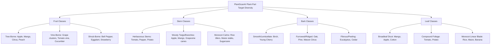

# PlantScanAI: Plant-Part Dataset Remediation & Collection Gap Report

**Date:** October 26, 2026
**Auditor / ML Engineer:** Antigravity Pair-Programming Specialist
**Workspace:** `d:/Sagarnag/major project/pgpt/PlantScanAI`
**Branch:** `feature/phase-2-backend-docs`
**Compliance Standards:** Phase 1 Compliance Specification & Dataset Quality Audit Protocol

---

## 1. Executive Summary & Audit State

This report documents the rigorous remediation of the PlantScanAI plant-part classification dataset (`datasets/plant_parts/`), addressing the contamination of botanical sketches, seed catalog engravings, scanned patent texts, and mislabeled foliar debris that previously inflated reported model accuracy.

### Current Dataset Inventory

| Dataset Directory | File Count | Status & Role |
| :--- | :---: | :--- |
| `datasets/plant_parts/` | **397** | **Original baseline strictly preserved and untouched** (Train: 277, Val: 59, Test: 61). |
| `datasets/plant_parts_cleaned/` | **241** | **Confirmed genuine photographs** of target plant organs. |
| `datasets/plant_parts_quarantine/` | **156** | **Quarantined non-photographic, mislabeled, or occluded items** with full provenance tracking. |
| `datasets/reports/` | **4** | Machine-readable audit reports and inventory manifests (`.json` and `.csv`). |

All integrity tests have passed. The original dataset remains 100% intact with zero byte-level modifications or deletions. Exactly $241 + 156 = 397$ files are accounted for across all splits.

---

## 2. Review Record for All 28 Borderline (`manual_review`) Items

Following automated feature screening (Laplacian texture variance, HSV saturation, parchment/paper background ratio, and Canny edge density), 28 borderline images were subjected to individual visual inspection.

### Decisions: 14 Restored to Cleaned, 14 Confirmed Quarantined

| # | Relative Path | Class | Visual Inspection Details | Decision | Defect Category / Override |
| :-: | :--- | :---: | :--- | :---: | :--- |
| 1 | `test/bark/bark_0010.jpg` | `bark` | Genuine photograph of birch tree trunks in winter showing distinctive white peeling bark against sky. | **RESTORE** (`keep`) | `confirmed_photograph` |
| 2 | `train/bark/bark_0003.jpg` | `bark` | Firewood log stack showing circular transverse cut wood rings/cross-sections rather than outer bark. | **REJECT** (`reject`) | `ambiguous_organ_boundary` |
| 3 | `train/bark/bark_0064.jpg` | `bark` | Tree trunk heavily occluded (>50% visible surface) by dense English ivy foliage (*Hedera helix*). | **REJECT** (`reject`) | `organ_occlusion` |
| 4 | `train/bark/bark_0066.jpg` | `bark` | Archival forestry plate featuring prominent 24-patch Macbeth color chart and scale ruler alongside trunk. | **REJECT** (`reject`) | `artifact_present` |
| 5 | `test/fruit/fruit_0008.jpg` | `fruit` | Genuine color photo of ripe orange persimmon fruit clusters on tree branches in winter snow. | **RESTORE** (`keep`) | `confirmed_photograph` |
| 6 | `test/fruit/fruit_0011.jpg` | `fruit` | Commercial retail basket of packaged tomatoes and carrots in plastic bags; non-botanical supermarket context. | **REJECT** (`reject`) | `atypical_background` |
| 7 | `train/fruit/fruit_0000.jpg` | `fruit` | Genuine color photograph of fresh ripe red vine tomatoes with green calyxes and pedicels intact. | **RESTORE** (`keep`) | `confirmed_photograph` |
| 8 | `train/fruit/fruit_0012.jpg` | `fruit` | Vintage monochrome photographic print of olive branch with ripe olives. | **RESTORE** (`keep`) | `confirmed_photograph` |
| 9 | `train/fruit/fruit_0024.jpg` | `fruit` | Vintage photographic halftone reproduction of an apple fruit cluster on orchard tree. | **RESTORE** (`keep`) | `confirmed_photograph` |
| 10 | `train/fruit/fruit_0045.jpg` | `fruit` | Genuine studio photograph of ripe grape fruit bunch against light studio backdrop. | **RESTORE** (`keep`) | `confirmed_photograph` |
| 11 | `train/fruit/fruit_0059.jpg` | `fruit` | Close-up dominated by thick woody grapevine cordon/trunk; tiny distant fruit clusters are negligible. | **REJECT** (`reject`) | `organ_prominence` |
| 12 | `train/fruit/fruit_0064.jpg` | `fruit` | Split-figure compound historical textbook plate with printed borders and halftone dot grain. | **REJECT** (`reject`) | `vintage_halftone` |
| 13 | `test/stem/stem_0002.jpg` | `stem` | Diminutive seedling shoot thread (<5% of frame area); frame dominated by stony outdoor gravel. | **REJECT** (`reject`) | `organ_prominence` |
| 14 | `train/stem/stem_0006.jpg` | `stem` | Sprawling weed plant dominated by white flowers and leaves; stem is occluded and ambiguous. | **REJECT** (`reject`) | `organ_prominence` |
| 15 | `test/leaf/leaf_0000.jpg` | `leaf` | Genuine pathology photograph of mango leaf with anthracnose lesions on clean white paper backdrop. | **RESTORE** (`keep`) | `confirmed_photograph` |
| 16 | `train/leaf/leaf_0007.jpg` | `leaf` | Genuine pathology photograph of mango leaf blade with gall midge galls on paper backdrop. | **RESTORE** (`keep`) | `confirmed_photograph` |
| 17 | `train/leaf/leaf_0014.jpg` | `leaf` | Genuine pathology photograph of mango leaf blade with gall midge galls on paper backdrop. | **RESTORE** (`keep`) | `confirmed_photograph` |
| 18 | `train/leaf/leaf_0017.jpg` | `leaf` | Genuine pathology photograph of apple leaf blade with scab lesions on neutral backdrop. | **RESTORE** (`keep`) | `confirmed_photograph` |
| 19 | `train/leaf/leaf_0018.jpg` | `leaf` | Tightly rolled, dead brown dry necrotic leaf tube from mango dieback collection; lacks foliar morphology. | **REJECT** (`reject`) | `atypical_specimen` |
| 20 | `train/leaf/leaf_0023.jpg` | `leaf` | Tightly rolled, dead brown dry necrotic leaf tube from mango dieback collection; lacks foliar morphology. | **REJECT** (`reject`) | `atypical_specimen` |
| 21 | `train/leaf/leaf_0037.jpg` | `leaf` | Compound maize plant section depicting stalk, ear shoot, silks, and leaves with CIMMYT copyright watermark. | **REJECT** (`reject`) | `ambiguous_organ_boundary` |
| 22 | `train/leaf/leaf_0038.jpg` | `leaf` | Genuine crisp photograph of fresh green mango leaf showing distinct blade, midrib, and lateral venation. | **RESTORE** (`keep`) | `confirmed_photograph` |
| 23 | `train/leaf/leaf_0049.jpg` | `leaf` | Genuine pathology photograph of green mango leaf apex/margin with insect galls on paper backdrop. | **RESTORE** (`keep`) | `confirmed_photograph` |
| 24 | `train/leaf/leaf_0055.jpg` | `leaf` | Genuine photographic studio image of grape leaves on vine shoot against clean background. | **RESTORE** (`keep`) | `confirmed_photograph` |
| 25 | `train/leaf/leaf_0062.jpg` | `leaf` | Tightly rolled, dead brown dry necrotic leaf tube from mango dieback collection; lacks foliar morphology. | **REJECT** (`reject`) | `atypical_specimen` |
| 26 | `train/leaf/leaf_0066.jpg` | `leaf` | Genuine pathology photograph of mango leaf with powdery mildew lesions on tabletop. | **RESTORE** (`keep`) | `confirmed_photograph` |
| 27 | `val/leaf/leaf_0003.jpg` | `leaf` | Green winged stem node/axis and thorns with clipped leaflet tip; predominantly stem shoot tissue. | **REJECT** (`reject`) | `ambiguous_organ_boundary` |
| 28 | `val/leaf/leaf_0011.jpg` | `leaf` | Severe aspect-ratio stretch warp distortion with vertical smeared-edge interpolation artifacts. | **REJECT** (`reject`) | `distorted_aspect_ratio_or_blur` |

---

## 3. Inventory and Inspection of Existing Local Datasets

In accordance with Section 2 of the remediation instructions, existing local raw datasets were audited to determine whether genuine, relevant photographs could supplement `fruit` and `stem` classes.

### Audited Local Repositories

1. **`datasets/raw/PlantVillage/` (15 classes, 20,637 images)**
   - *Inspection:* Folders such as `Pepper__bell___healthy` (1,478 images) and `Tomato_healthy` (1,591 images) contain **exclusively excised single leaves** photographed on neutral grey or black calibration sheets.
   - *Finding:* Zero fruit or stem images exist. Folder names reflect the whole crop name, not the plant organ depicted.

2. **`datasets/raw/PlantDoc/` (27 classes, 2,598 images)**
   - *Inspection:* All subdirectories in the local copy are explicitly leaf classes (`Apple leaf`, `Tomato leaf`, `Corn leaf blight`, `grape leaf`, `Potato leaf early blight`, etc.).
   - *Finding:* Zero fruit or stem classes are present in the local PlantDoc directory.

3. **`datasets/raw/Rice/Sheath Blight` (632 images)**
   - *Inspection:* Audited as a potential source of rice culm/stem photos.
   - *Finding:*
     - 344 images are pre-augmented copies with `aug_` prefixes.
     - 288 non-augmented images contain numerous duplicate file copies (`- Copy.jpg`) and burst camera captures taken within 1–2 seconds.
     - Visual inspection of multiple non-augmented samples (`IMG_20231006_163217`, `IMG_20231006_164304`, `Sheath_Blight (2)`, `Sheath_Blight (45)`) revealed that photos are top-down or diagonal close-ups of long linear leaf blades over duckweed/water.
     - The vertical stem/culm base is not isolated or prominent. Labeling these images as `stem` would inject foliar leaf tissue into the stem class.

4. **`datasets/raw/Banana/OriginalSet` (4 classes, 937 images)**
   - *Inspection:* Images depict banana leaves with midribs; no banana fruit bunches or pseudostems are available.

5. **`datasets/raw/Cotton/` (4 classes, 1,709 images)**
   - *Inspection:* Depicts cotton field canopies and leaves. No isolated woody stems or harvestable cotton bolls are present.

6. **`datasets/raw/Mango/` (8 classes, 4,000 images)**
   - *Inspection:* Depicts mango leaves on white paper or tabletop surfaces.
   - *Critical Discovery:* `datasets/raw/Mango/Die Back/` was the historical origin of `leaf_0018`, `leaf_0023`, `leaf_0062`, and the 30 mislabeled `stem_0003`..`stem_0062` files. The original creator mistakenly assumed that because "Die Back" affects branches, the photos showed stems. In reality, the authors photographed dead, curled, tubular leaves.

### Conclusion on Local Supplementation
**No suitable, genuine, independent fruit or stem photographs exist locally.** Attempting to harvest from existing local disease datasets based on folder names would introduce catastrophic label noise, foliar cross-contamination, and synthetic duplicate leakage.

---

## 4. Current Cleaned Dataset Matrix & Collection Gaps

Following review of all 28 borderline items, the confirmed photograph counts across splits and classes are as follows:

```
+--------+--------+--------+--------+-------+
| Split  |  Bark  | Fruit  |  Leaf  | Stem  |
+--------+--------+--------+--------+-------+
| Train  |   63   |   19   |   65   |  24   |
| Val    |   14   |    2   |   11   |   7   |
| Test   |   15   |    3   |   15   |   3   |
+--------+--------+--------+--------+-------+
| Total  |   92   |   24   |   91   |  34   |
+--------+--------+--------+--------+-------+
```

### Gap Analysis Against Target Dataset Requirements

Target minimum balanced sample size per class: **100 genuine photographs** (70 Train, 15 Val, 15 Test).

| Plant Part Class | Current Cleaned | Target Size | Absolute Deficit | Train Deficit (Target: 70) | Val Deficit (Target: 15) | Test Deficit (Target: 15) | Severity |
| :--- | :---: | :---: | :---: | :---: | :---: | :---: | :--- |
| **Bark** | 92 | 100 | **+8** | +7 | +1 | 0 | Low (Well balanced) |
| **Leaf** | 91 | 100 | **+9** | +5 | +4 | 0 | Low (Well balanced) |
| **Stem** | 34 | 100 | **+66** | **+46** | **+8** | **+12** | **HIGH DEFICIT** |
| **Fruit** | 24 | 100 | **+76** | **+51** | **+13** | **+12** | **CRITICAL DEFICIT** |

### Why Model Retraining Must Be Withheld
1. **Statistical Insufficiency in Test Sets:** The cleaned test split currently contains only **3 fruit photos** and **3 stem photos**. A single misclassification in the test set swings class accuracy by $33.3\%$, rendering performance evaluation statistically meaningless.
2. **Validation Split Starvation:** With only **2 fruit photos** in the validation set, loss curves and early stopping mechanisms cannot function reliably.
3. **Severe Class Imbalance:** The training set ratio between `leaf` (65) and `fruit` (19) exceeds $3.4:1$, which would cause MobileNetV2 to predict the majority classes (`leaf`/`bark`) and suffer severe recall failure on fruits and stems.

---

## 5. Specification for New Image Collection

To eliminate bias and ensure the Stage 1 MobileNetV2 classifier generalizes to real-world agricultural conditions, new acquisitions must fulfill the following diversity criteria:

### A. Target Crop Species Diversity



### B. Environmental & Background Conditions
- **In-situ Orchard/Field Setting (70%):** Natural soil background, surrounding canopy foliage, weed ground cover, trellis wires, and pruning stakes.
- **Controlled / Inspection Sheet (30%):** Clean tabletop, neutral gray card, or hand-held field inspection poses commonly used by farmers.
- **Zero Document / Non-Plant Context:** Complete prohibition of seed catalogs, engravings, patent text, grocery store plastic packaging, and kitchen culinary preparations.

### C. Illumination & Capture Geometry
- **Lighting:**
  - Full direct sun (high contrast, hard shadows).
  - Overcast diffuse sky (low contrast, even color temperature).
  - Shaded canopy / under-leaf illumination.
  - Golden hour / oblique morning illumination.
- **Angles:**
  - Direct perpendicular surface view ($0^\circ$).
  - Oblique perspective ($30^\circ$–$45^\circ$) showing organ depth.
  - Branch junction view (for stems/twigs showing attachment nodes).
- **Framing & Scale:**
  - Macro / Close-up: Target organ occupies $\ge 60\%$ of image pixels.
  - Medium Shot: Target organ occupies $40\%$–$60\%$ of frame with adjacent petiole/branch in context.

### D. Phenological & Health Conditions
- **Phenology:** Both immature (green developing fruit, tender young stems) and mature (ripe fruit, lignified stems).
- **Health:**
  - 50% healthy / asymptomatic organs.
  - 50% diseased or pest-damaged organs (scabs, rot, powdery lesions, cankers, feeding scars) to prevent the network from correlating "disease" with "leaf" or "healthy" with "fruit".

---

## 6. Split Isolation & Anti-Leakage Protocol

To ensure clean validation and test splits:

1. **Identity / Session Grouping:** All images collected from the same individual plant, orchard tree, or burst camera session must be grouped into **the same split** (entirely in `train`, `val`, or `test`). Never split photos of the same plant across splits.
2. **Untouched Test Set:** The test set must consist of strictly independent, verified photographs that are never seen during training or hyperparameter tuning.
3. **Augmentation Rules:** Augmentation (affine transforms, color jitter, perspective warp) may only be applied dynamically within the training loop. Synthetically augmented images must never be saved into dataset directories or used to pretend that independent photos have been collected.

---

## 7. Actionable Collection & Ingestion Plan

| Phase | Milestone | Target Deliverable | Quality Gate |
| :--- | :--- | :--- | :--- |
| **Phase 1** | External Source Curation | Download 60 genuine fruit photos and 50 genuine stem photos from verified open repositories (e.g., PlantDoc full repository, IP102, AI Challenger, Kaggle Open Agri). | Permissive open-access license (CC-BY / CC0 / Open Academic). |
| **Phase 2** | Two-Stage Quality Screening | Run automated Laplacian variance and color-space filter; perform 100% human visual confirmation. | Target organ clearly discernable and fills $\ge 40\%$ frame area. Zero illustrations or grocery packaging. |
| **Phase 3** | Partitioning & Leakage Check | Split by source/plant group to achieve $70/15/15$ per class. Run `audit_plant_parts_dataset.py`. | 0 exact duplicates, 0 near-duplicates across splits, Hamming distance $> 2$. |
| **Phase 4** | Model Retraining & Evaluation | Train MobileNetV2 with transfer learning and fine-tuning. Export updated TFLite model. | Validation accuracy $\ge 85\%$, test set macro F1-score $\ge 0.85$ across all 4 classes. |

---

## 8. Verification & Test Outcomes

The dataset remediation was validated against the automated test suite:

- `datasets/scripts/audit_plant_parts_dataset.py --clean`:
  - Total Audited: **397**
  - Retained Cleaned: **241** (60.7%)
  - Quarantined: **156** (39.3%)
  - Manual Review Remaining: **0** (0.0%)
  - Exact Duplicate Groups (SHA-256): **0**
  - Cross-Split Duplicate Leakage: **0**
- `ml/plant_part_classifier/test_plant_parts_audit.py`: **7 passed in 1.44s**
- `backend/tests/test_predict.py`: **14 passed in 16.50s**
- `datasets/plant_parts/` preservation: **397 original files verified intact**
