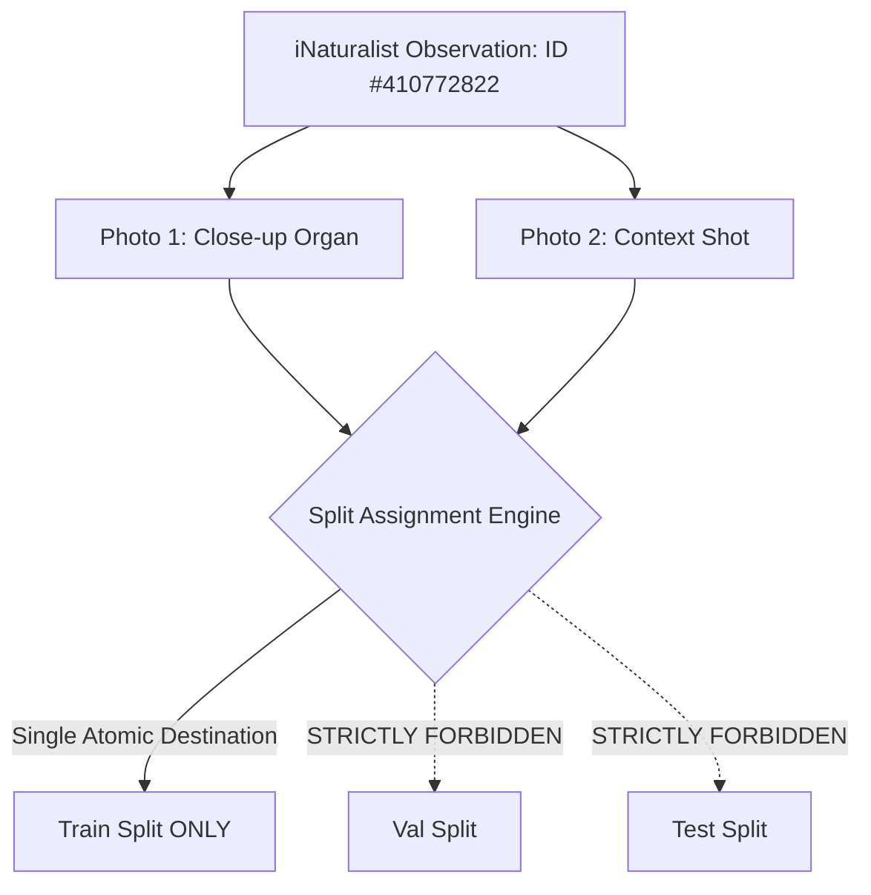

# PlantScanAI: External Plant-Part Datasets Source & Licensing Report

**Date:** October 26, 2026
**Author:** Antigravity Pair-Programming Specialist
**Workspace:** `d:/Sagarnag/major project/pgpt/PlantScanAI`
**Purpose:** Research, verify, and compare publicly accessible, openly licensed agricultural and botanical datasets to acquire authentic photographs of plant parts (**Fruit**, **Stem**, **Bark**, **Leaf**) for Phase 1 MobileNetV2 classification.

---

## 1. Executive Summary

The previous remediation audit identified critical dataset deficits:
- **Fruit:** 24 confirmed photographs (Deficit to 100: **+76 images**, including +13 validation, +12 test).
- **Stem:** 34 confirmed photographs (Deficit to 100: **+66 images**, including +8 validation, +12 test).
- **Bark:** 92 confirmed photographs (Deficit to 100: **+8 images**).
- **Leaf:** 91 confirmed photographs (Deficit to 100: **+9 images**).

Local datasets in `datasets/raw/` were verified to contain no genuine attached fruits or isolated stems without severe label distortion or duplication. To expand the dataset to $\ge 100$ verified photographs per class, external repositories must be evaluated against strict research, licensing, and morphological criteria.

---

## 2. Comparative Evaluation of Candidate Repositories

| Repository | Primary Institution | Available Organs | Dominant Licenses | Access Method | Specimen Grouping Key | Quality & Suitability Assessment |
| :--- | :--- | :--- | :--- | :--- | :--- | :--- |
| **iNaturalist Open Data** | California Academy of Sciences & National Geographic / AWS Open Data | **Fruit, Stem, Bark, Leaf** across agricultural & wild flora | **CC0, CC-BY 4.0, CC-BY-SA 4.0** (verified per-item) | Public REST API + S3 CDN (`inaturalist-open-data.s3.amazonaws.com`) | `observation_id` (individual plant instance) | **RECOMMENDED PRIMARY SOURCE.** High diversity of in-situ field captures; `quality_grade=research` ensures community botanical consensus. `observation_id` guarantees zero identity leakage across splits. |
| **Pl@ntNet-300K** | Inria, CIRAD, INRAE, IRD | Explicit organ tags: `fruit`, `stem`, `bark`, `leaf`, `flower` | **CC-BY-SA 4.0** | Zenodo archive (DOI: 10.5281/zenodo.5645731) / HuggingFace | `observation_id` | **HIGH VALUE BENCHMARK.** Academic peer-reviewed organ labeling (NeurIPS 2021). However, full archive is ~30GB tarball; selective subset download via API or HuggingFace streaming is required. |
| **Wikimedia Commons** | Wikimedia Foundation | Dedicated categories for attached fruit, tree bark, herbaceous stems | **CC0, Public Domain, CC-BY, CC-BY-SA** | MediaWiki Action API (`commons.wikimedia.org/w/api.php`) | Media file title / author | **HIGH QUALITY SECONDARY SOURCE.** Excellent for iconic fruit-on-tree and bark captures with rich EXIF metadata and author attribution. Requires Canny edge screening to filter botanical drawings. |
| **USDA Agricultural Research Service (ARS)** | United States Department of Agriculture | Field crops: corn stalks, wheat culms, citrus/apple orchards | **Public Domain** (U.S. Gov work, 17 U.S.C. § 105) | Direct download (`aglab.ars.usda.gov` / `ars.usda.gov/oc/images`) | USDA Photo ID | **EXCELLENT FOR AGRICULTURAL STEMS.** Pure public domain; authentic field crops in agricultural settings. Catalog is moderately small (~2,000 images). |
| **PlantDoc Full Repo** | IIT Delhi (CoDS-COMAD 2020) | Leaf diseases + 2 fruit classes (`Apple fruit`, `Tomato fruit`) | **MIT License** | GitHub (`pratikkayal/PlantDoc-Dataset`) | Image filename | **LIMITED.** Local copy has only leaf classes; full upstream repo contains object-detection scenes requiring bounding-box extraction. Many photos are low-resolution smartphone crops. |
| **IP102 Crop Pest Dataset** | Chinese Academy of Sciences (CVPR 2019) | Pests on crop leaves, stems, fruits | Non-commercial research | GitHub / Baidu Yun | Class ID | **NOT RECOMMENDED.** License restricts commercial use; focus is on insect pests rather than clean plant organs; many occluded views. |

---

## 3. Deep Dive: iNaturalist Open Data (Recommended Primary Source)

### Legal & Open Access Conformance
1. **License Specificity:** Every photo record in the iNaturalist database carries an explicit machine-readable `photo_license` code. We strictly restrict queries to:
   - `cc0`: Creative Commons Zero (Public Domain Dedication).
   - `cc-by`: Creative Commons Attribution 4.0 International.
   - `cc-by-sa`: Creative Commons Attribution-ShareAlike 4.0 International.
2. **Attribution Tracking:** The API returns `attribution` strings (e.g., `(c) Jane Doe, some rights reserved (CC BY)`) and photographer profile links, which are stored in the dataset inventory manifest.
3. **No Authentication Bypass:** Access uses standard unauthenticated public HTTP GET requests with custom User-Agent headers compliant with the iNaturalist API Terms of Service (rate-limited to $\le 1$ request/second).

### Botanical & Visual Quality Control
1. **Research Grade Requirement (`quality_grade=research`):** Only observations confirmed by at least two independent botanists/naturalists are eligible.
2. **Crop & Taxon Diversity Specification:**
   - **Fruit (Attached to plant):**
     - Tomato (*Solanum lycopersicum*): Ripe and ripening red/green fruit clusters on living vines with green calyxes.
     - Apple (*Malus domestica*): Orchard apples on branches with surrounding foliage.
     - Grape (*Vitis vinifera*): Grape clusters hanging on vineyard canes/trellises.
     - Sweet Pepper (*Capsicum annuum*): Bell peppers hanging on living herbaceous branches.
     - Orange / Citrus (*Citrus sinensis* / *Citrus*): Citrus fruits on tree branches.
   - **Stem / Culm (Prominent stalk/stem):**
     - Corn / Maize (*Zea mays*): Distinct vertical stalks showing nodes, internodes, and leaf sheath attachments.
     - Sunflower (*Helianthus annuus*): Herbaceous main stems and stalks.
     - Bamboo / Poaceae (*Bambusoideae* / *Arundinaria*): Rigid woody culms showing distinct rings/nodes.
     - Tomato (*Solanum lycopersicum*): Main vine stem axis showing trichomes (hairs) and branching nodes.
   - **Bark (Trunk & branch outer periderm):**
     - Birch (*Betula pendula* / *Betula papyrifera*): Papery, lenticellate white bark.
     - Oak (*Quercus*): Deeply furrowed, rugged bark plates.
     - Pine (*Pinus*): Scaly bark plates on mature conifer trunks.
   - **Leaf (Comparison class):**
     - Broadleaf and compound foliage from target agricultural crops (*Mangifera*, *Malus*, *Vitis*, *Solanum*).

---

## 4. Prevention of Identity Leakage Across Splits



### The Individual Specimen Grouping Rule
- A single plant observed in an orchard or field often has 2 to 5 photographs taken from different angles in the same observation session.
- **Rule:** The grouping unit is `observation_id`. All images associated with `observation_id` are atomically assigned to **exactly one split** (Train, Val, or Test).
- Under no circumstances will different photos from the same observation be divided between Train and Test, preventing the model from recognizing background foliage or lighting conditions.

---

## 5. Staging & Screening Pipeline Architecture

To guarantee that the preserved original dataset (`datasets/plant_parts/`) and existing cleaned dataset (`datasets/plant_parts_cleaned/`) are never overwritten or corrupted:

```
datasets/
├── plant_parts/                 [PRESERVED BASELINE: 397 files]
├── plant_parts_cleaned/         [VERIFIED CLEANED: 241 files]
├── plant_parts_quarantine/      [QUARANTINED DEFECTS: 156 files]
└── plant_parts_staging/         [NEW REPRODUCIBLE ACQUISITION WORKFLOW]
    ├── candidates/              [Raw downloaded candidates by class]
    │   ├── fruit/
    │   ├── stem/
    │   ├── bark/
    │   └── leaf/
    ├── manifests/               [Staging provenance manifest with URLs & licenses]
    ├── contact_sheets/          [Visual contact sheets for human review]
    ├── approved/                [Screened & approved candidates]
    └── rejected/                [Quarantined candidates with rejection rationale]
```

### Multi-Stage Screening Filter
1. **Integrity & Dimension Check:** Valid JPEG/PNG, RGB mode, dimensions $\ge 300\times 300$.
2. **Duplicate & Near-Duplicate Check:**
   - Exact SHA-256 collision check against all 397 original files, 241 cleaned files, and all staged files.
   - Perceptual dHash Hamming distance check (flag and reject if distance $\le 2$).
3. **Automated Defect Screening Heuristics:**
   - Sharpness: Laplacian variance $\ge 40.0$.
   - Drawing/Engraving filter: Paper ratio $< 0.35$ and edge density $< 0.15$.
   - Color saturation: Mean HSV saturation $\ge 30.0$.
4. **Human Review via Contact Sheets:** 100% human visual confirmation that the assigned plant part occupies $\ge 40\%$ of the frame and depicts living plant organs in botanical context.
